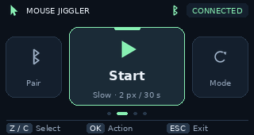
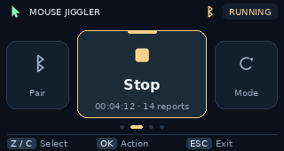
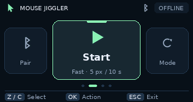

# Mouse Jiggler for CardputerZero

A Bluetooth HID mouse that lives in your pocket. The CardputerZero pairs with a
computer as a real mouse and nudges the pointer in one of three rhythms — slow,
fast, or a constant jiggle — so a machine that watches for input stays awake.




*Captured on the device:* 

The UI is modelled on [Ultimate-Remote](https://github.com/geo-tp/Ultimate-Remote)'s
CardputerZero renderer (palette, card geometry, hint bar), so both apps look like
siblings on the same 320×170 panel.

## Features

- **Classic Bluetooth HID mouse** — no dongle, no USB cable, works with Windows,
  macOS and Linux hosts.
- **Three modes** — Slow (2 px / 30 s), Fast (5 px / 10 s), Jiggle
  (20–30 px every 100 ms).
- **Start / Stop** — Stop sends an explicit zero report; no stuck buttons, no
  pointer drifting off-screen.
- **Pairing from the device** — 180 s discoverable window with a live countdown,
  auto-accept "Just Works" agent, bond persisted by BlueZ.
- **Re-pair and forget** — re-pair confirmation page unlinks the old host first.
- **Rename** — type a new Bluetooth name on the device keyboard; it updates the
  adapter alias and the SDP record immediately and is saved for next boot.
- **Launcher integration** — APPLaunch icon with the launcher's grey tile border, clean exit back to HOME.

## Requirements

| | |
| --- | --- |
| Device | M5Stack CardputerZero (C154/C155), Raspberry Pi CM0, 320×170 panel |
| OS packages | `python3-pil`, `python3-dbus`, `bluez` (`python3-gi` for the pairing agent) |
| Privileges | `CAP_NET_BIND_SERVICE` only (the package ships a capability launcher; no root) |

## Install

```bash
scp -r cardputer-zero-mouse-emu pi@cardputerzero.local:~/
ssh pi@cardputerzero.local
sudo apt install python3-pil python3-dbus python3-gi
cd cardputer-zero-mouse-emu
sudo ./install.sh
sudo ./install.sh bluetooth-fix      # frees L2CAP PSMs 0x11/0x13 (see below)
```

`install.sh` copies the app into `/usr/share/APPLaunch`, adds the `.desktop`
entry and icon, and restarts APPLaunch (system or user service). Press **ESC**
to reach HOME, scroll to **Mouse Jiggler**, press **OK**.

### Why `bluetooth-fix`?

BlueZ's `input` plugin holds the HID-device PSMs, so the app cannot bind them
and reports `HID channels busy`. The fix adds a systemd drop-in running
`bluetoothd -P input`. It disables Bluetooth HID *host* support (connecting a
keyboard/mouse **to** the CardputerZero); `sudo ./install.sh bluetooth-restore`
undoes it.

Building a `.deb` instead:

```bash
./packaging/build-deb.sh          # dist/mouse-jiggler_0.2.2_arm64.deb
sudo apt install ./dist/mouse-jiggler_0.2.2_arm64.deb
```

The builder also runs in a container, so any machine with Docker can produce
the package (see [docs/install.md](docs/install.md#debian-package)).

See [docs/install.md](docs/install.md) for details, manual runs and uninstall.

## Use

| Input | Action |
| --- | --- |
| `Z` / `C` (or `←` / `→`) | move the carousel selection |
| `OK` / `Enter` | activate the centred card |
| `ESC` tap | exit from the main screen; cancel pairing, rename or re-pair elsewhere |

**Rename:** select the **Rename** card and press `OK`. Typing replaces the old
name (select-all), `Backspace` edits, `OK` saves, `ESC` cancels. Names are
limited to 20 characters: letters, digits, space, `-`, `_` and `.`.

**First run:** select **Pair** and press `OK`. The device becomes discoverable
for three minutes and shows the name `CardputerZero Mouse`. Add it from the
host's Bluetooth settings. Once connected, select **Start** and press `OK`.

**Modes**

| # | Name | Movement | Rate |
| --- | --- | --- | --- |
| 1 | Slow | 2 px, alternating direction | every 30 s |
| 2 | Fast | 5 px, alternating direction | every 10 s |
| 3 | Jiggle | 20–30 px random vector, undone next tick | every 100 ms |

Alternating vectors keep the pointer around its starting point: no slow drift
across the screen, no runaway.

More in [docs/usage.md](docs/usage.md).

## Documentation

| Document | Contents |
| --- | --- |
| [PLAN.md](PLAN.md) | architecture, transport choice, state machine, milestones, risks |
| [docs/install.md](docs/install.md) | install, `.deb`, manual run, uninstall |
| [docs/publish.md](docs/publish.md) | `app-builder.json`, czdev publish, store preflight |
| [docs/usage.md](docs/usage.md) | pairing, modes, states, battery and screen notes |
| [docs/development.md](docs/development.md) | dev setup, tests, fakes, adding screens, assets |
| [docs/troubleshooting.md](docs/troubleshooting.md) | adapter, pairing, framebuffer, permissions |
| [docs/hardware-verification.md](docs/hardware-verification.md) | M0 evidence: pairing, enumeration, REL events |
| [docs/protocol.md](docs/protocol.md) | SDP record, report descriptor, HIDP, M0 spike |
| [docs/ui-spec.md](docs/ui-spec.md) | pixel-level UI specification (incl. Rename editor) |
| [AGENTS.md](AGENTS.md) | guide for coding agents working in this repo |

## Development

```bash
python3 -m pytest tests -q          # full suite, no device required
ruff check src tests tools
python3 tools/render_assets.py     # regenerate docs/ui-*.png + icon
PYTHONPATH=src python3 -m mouse_jiggler --help
```

The app loop is a plain object with an injectable clock, transport, display and
keypad (`src/mouse_jiggler/app.py`), so the whole state machine is tested with
fakes in `tests/support.py` — no Bluetooth adapter or framebuffer needed.

## Status and limitations

- **Verified on hardware (2026-11-16).** Paired from a Linux desktop; the host
  enumerated `CardputerZero Mouse` as a mouse (`/dev/input/event256`) and
  received the ±3 px reports as `REL_X` events. Evidence and commands:
  [docs/hardware-verification.md](docs/hardware-verification.md).
- The UI, state machine, report encoding, HIDP framing and packaging are
  implemented and covered by 80 tests.
- The app runs as root (PSM binding), so it is not eligible for the official
  App Store, which rejects root-privileged apps. Sideload only.
- Use it on machines you own or are authorised to control. It defeats idle
  detection; that can violate a workplace policy.
- **No root at runtime**: L2CAP PSMs 0x11/0x13 need `CAP_NET_BIND_SERVICE`, so
  the package installs `/usr/lib/mouse-jiggler/caplaunch` with that one file
  capability. Without it (plain `install.sh` on a compiler-less system) the
  wrapper falls back to `sudo -n`.

## Credits

- UI language and layout metrics: [Ultimate-Remote](https://github.com/geo-tp/Ultimate-Remote) (MIT)
- Bluetooth HID device approach: [PiKVM](https://github.com/pikvm/kvmd) (GPL-2.0, used as protocol reference only)
- Device documentation: [M5Stack CardputerZero docs](https://docs.m5stack.com/en/CardputerZero)

## License

MIT — see [LICENSE](LICENSE).
