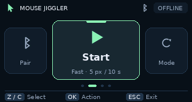
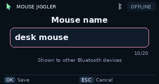

# Hardware verification (M0)

Date: **2026-11-16** · device: CardputerZero (Debian 13 trixie, kernel
6.18.39+rpt-rpi-v8, BlueZ 5.82) · adapter `F0:40:AF:90:55:E7` · host: Linux
desktop, adapter `EC:91:61:22:61:CA`.

This is the M0 gate from [PLAN.md](../PLAN.md): prove that the device can pair
with a real computer and deliver HID mouse reports. The UI was not involved —
the test drove `BluetoothTransport` directly.

## 1. Device brings the stack up

```text
INFO mouse_jiggler.platform.fb: framebuffer /dev/fb0: 320x170 16bpp line_length=640
INFO mouse_jiggler.input.keypad: keyboard: /dev/input/by-path/platform-3f804000.i2c-event
DEBUG mouse_jiggler.bt.agent: GLib D-Bus main loop started
INFO mouse_jiggler.bt.profile: using adapter hci0 (F0:40:AF:90:55:E7)
INFO mouse_jiggler.bt.server: listening for HID hosts on F0:40:AF:90:55:E7 (PSM 0x11/0x13)
INFO mouse_jiggler.bt.profile: HID profile registered at /org/bluez/mousejiggler
INFO mouse_jiggler.bt.agent: pairing agent registered (NoInputNoOutput)
INFO mouse_jiggler.app: Bluetooth ready
```

## 2. Host discovers and pairs

```bash
$ bluetoothctl --timeout 28 scan bredr
[NEW] Device F0:40:AF:90:55:E7 CardputerZero Mouse

$ bluetoothctl pair F0:40:AF:90:55:E7
BREDR.Paired: yes
BREDR.Bonded: yes
UUID: Human Interface Device (00001124-0000-1000-8000-00805f9b34fb)
```

Device side:

```text
CONNECTED desktop EC:91:61:22:61:CA
```

## 3. The app on the device

Framebuffer dumped from the running app (`/dev/fb0`, RGB565):



## 4. Host enumerates a mouse

```text
N: Name="CardputerZero Mouse"
H: Handlers=event256 mouse3
B: EV=17                     # SYN | KEY | REL
```

A new `/dev/input/event256` with the exact device name, created from our 64-byte
report descriptor via `hid-generic`/`uhid`.

## 5. Host receives movement

Reports were sent as ±3 px on X, alternating. Reading the event node from a
privileged container gave:

```text
events 7 REL [[0,-3],[0,3],[0,-3],[0,3]] count 4
```

`REL_X` (`code 0`) values match the reports sent by the device byte for byte:
the full SDP → HIDP → report → input-subsystem chain works.

## 5.1 Rename (2026-11-17)

The `Rename` card was exercised with the real transport and a scripted keypad:
typing `desk mouse` replaced the prefilled name, saved it to `config.json`,
updated the adapter alias and re-registered the SDP record. A fresh BR/EDR scan
from the host then showed:

```text
[NEW] Device F0:40:AF:90:55:E7 desk mouse
```

The editor on the panel (launcher stopped for the capture):



## 6. Findings that changed the implementation

| Finding | Fix |
| --- | --- |
| `fb_var_screeninfo.bits_per_pixel` was read from the wrong offset (got 320 instead of 16) | `platform/fb.py` now parses bpp at offset 24, with a regression test |
| BlueZ's `input` plugin holds L2CAP PSMs 0x11/0x13, so the app got `EADDRINUSE` | `install.sh bluetooth-fix` installs a bluetoothd drop-in with `-P input` |
| `Adapter1.Class` is read-only on BlueZ 5.82 | the property is best-effort and logged at debug |
| APPLaunch runs desktop apps as the logged-in user, not root | the launcher wrapper re-execs itself through `sudo -n` |
| APPLaunch is a **user** service on this image | `install.sh` restarts both the system and `--user` service |
| The LCD is `panel-mipi-dbid` / `fb0`, not `st7789v` / `fb1` | detection already falls back to `fb0` |
| A crash during pairing can leave the adapter discoverable | `configure()` now forces `Pairable`/`Discoverable` off at startup |

## 7. Reproduction

```bash
# on the device
sudo /usr/share/APPLaunch/bin/mouse-jiggler --debug     # open the UI, press Pair
# on the host
bluetoothctl --timeout 30 scan bredr
bluetoothctl pair F0:40:AF:90:55:E7
bluetoothctl connect F0:40:AF:90:55:E7
grep -A4 CardputerZero /proc/bus/input/devices
```

Pairing requires the device to be in the pairing page (180 s window) and the
`-P input` bluetoothd fix to be installed.
