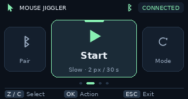
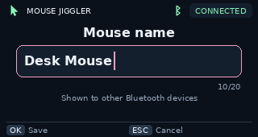
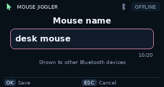

# UI layout spec — "Mouse Jiggler" on CardputerZero

The layout is modelled on **geo-tp/Ultimate-Remote**'s Linux framebuffer UI
(MIT). The palette, card geometry, header/footer bars, dot indicator and font
sizes below are taken from its `src/Platform/Linux/LinuxFramebufferView.cpp`
and `Assets/UiFont.h`, so the new app looks native next to it on the same
device.



> **Implemented** in `src/mouse_jiggler/ui/` (`theme.py` tokens, `screens.py`
> composition). The images in this folder are generated by
> `tools/render_assets.py` from that code — treat them as fixtures, not mockups.

| | |
| --- | --- |
| Canvas | 320 × 170, RGB565 framebuffer, 1 px = 1 px |
| Typeface | DejaVu Sans — Small 10 px, Body 12 px, Title 16 px Bold |
| Structure | top status bar (26 px) · card row · dots (y 141) · hint bar (19 px) |

## 1. Design tokens

| Token | Hex | Use |
| --- | --- | --- |
| `Background` | `#0b111a` | screen background, footer fill |
| `Panel` | `#141f2d` | inactive cards, status badge |
| `Card` | `#1b2b37` | active card fill |
| `Border` | `#27374a` | hairlines, inactive card borders, key chips |
| `Primary` | `#88f0b3` | Start, connected state, app accent |
| `Text` | `#edf3fa` | titles, key glyphs |
| `Muted` | `#95a6bb` | subtitles, side labels, hints |
| `Blue` | `#80baff` | Pair accent, pairing state |
| `Amber` | `#ffd18b` | Stop accent, running state |
| `Violet` | `#bda7ff` | Mode accent |
| `Pink` | `#f29ec0` | Rename accent |
| `Ink` | `#10241c` | text on accent fills (unused in v1) |

Every 1 px line is drawn at integer coordinates — no scaling, no fractional
positions. Icons are rasterised from 32-unit vector paths at 4× and
downsampled, matching the reference's supersampled masks.

## 2. Global chrome

### Header (0–25)

```
(8,4)    app glyph, 18 × 18 px, Primary        -> pointer / mouse
(33,7)   "MOUSE JIGGLER"  Small, Text
right    status glyph 16 × 16 at (badgeX-24, 5)
right    badge: w = textWidth(text)+14, h = 17, r = 5, fill Panel
         x = 320 - w - 8, y = 4
         text at (badgeX+7, 7)  Small, state color
(8,25)   hairline to (312,25), 1 px Border
```

### Hint bar (151–170)

```
(8,151)   hairline to (312,151), 1 px Border
slots     n = 3, slot = (320-16)/n = 101
chip      x, y+4, w = textWidth(key)+8, h = 12, r = 3, fill Border
key text  (x+4, y+4)  Small, Text
label     (x+chipW+5, y+4)  Small, Muted
```

Hints: `Z / C` Select · `OK` Action · `ESC` Exit.

## 3. Home screen (carousel)

Four items rotate through three fixed slots; the **selected** item is drawn in
the centre slot, larger. The two neighbours fill the side slots.

```
left card      x=7     y=46   w=71   h=77   r=11   fill Panel, border Border
centre card    x=87    y=34   w=146  h=99   r=11   fill Card,   border accent
right card     x=242   y=46   w=71   h=77   r=11   fill Panel, border Border
```

Rendering order per card: 1 px accent (or Border) rounded rect, then an inset
fill at +1 px / radius −1, then the content.

**Centre card**

| Element | Position |
| --- | --- |
| accent tab | 32 × 3, radius 1, centred on top edge, y = 34 |
| icon | 34 × 34, x = 87+(146−34)/2 = 143, y = 45 |
| title | Title 16 bold, centred, y = 86 |
| subtitle | Small 10, centred, y = 113 |

**Side card**

| Element | Position |
| --- | --- |
| icon | 25 × 25, centred, y = 59 |
| label | Small 10, centred, y = 98 |

**Dots (page indicator)** — one per carousel item (4), y = 141..144:

```
active   14 × 4, r=2, selected item's accent
inactive  5 × 4, r=2, Border
start x = (320 - ((4-1)*12 + 14)) / 2 = 135
advance 21 after the active dot, 12 after an inactive one
```

Carousel model: `items = [Pair, Start/Stop, Mode, Rename]`, `selected` defaults to
**Start** when a host is bonded and to **Pair** when not. Centre = `items[selected]`,
left = `items[(selected−1) % 3]`, right = `items[(selected+1) % 3]`.
`Z`/`C` (or `←`/`→`) rotate the selection; `OK` activates the centred item.

### Item content

| Item | Accent | Title | Subtitle |
| --- | --- | --- | --- |
| Pair | Blue | `Pair` | `Connected host` / `Connect a host` |
| Start | Primary | `Start` | `Slow · 2 px / 30 s` (rate of the current mode) |
| Stop | Amber | `Stop` | `00:04:12 · 14 reports` (elapsed · reports) |
| Mode | Violet | `Mode` | `Slow · 2 px / 30 s`, `Fast · 5 px / 10 s`, `Jiggle · 20-30 px / 100 ms` |
| Rename | Pink | `Rename` | current device name (ellipsized) |

Side-slot labels always use the item title; side icons and labels are `Muted`.

## 4. States

| State | Badge | Badge color | Centre card |
| --- | --- | --- | --- |
| Not bonded | `OFFLINE` | Muted | Pair selected by default |
| Bonded, idle | `CONNECTED` | Primary | Start, Primary accent |
| Running | `RUNNING` | Amber | Stop, Amber accent + timer |
| Pairing | `PAIRING 2:41` | Blue | Pairing page replaces the carousel |
| Re-pair | `CONNECTED` | Primary | Confirmation page (see §5) |
| Error | `BT ERROR` | Amber | Error page, `OK` retries, `ESC` exits |

Header badge text is dynamic, so its width is measured, not hard-coded.

## 5. Pairing page

Reuses the reference's status-page layout:

```
icon     28 × 28 Bluetooth glyph, (146, 35), Blue
title    "Pairing"  Title, centred, y = 73
line 1   "CardputerZero Mouse"  Body, centred, y = 103, Muted
line 2   "Add it in your computer's Bluetooth settings"  Small, centred, y = 123, Muted
hints    ESC Cancel
```

On success the page is replaced by the home screen with `CONNECTED`; on
timeout it returns to the previous selection with `OFFLINE`.

**Re-pair confirmation** uses the same status-page layout: Bluetooth icon, title
`Re-pair?`, lines `This forgets <host>` / `Pair again from scratch`, hints
`OK Forget` / `ESC Cancel`. Confirming removes the bond, drops the live L2CAP
link and opens a new 180 s pairing window.

## 5.1 Rename editor



Captured from the device: 

```
title      "Mouse name"  Title, centred, y = 31
box        (20,56) 280x40, r=8, 1 px Pink border + Panel fill
text       (30,66)  Title 16, Text; placeholder "Type a name" in Muted
cursor     2 px bar, y 64..86, Pink, after the text (blinks at 2 Hz)
counter    "<n>/20"  Small, Muted, right-aligned at y = 101
help       "Shown to other Bluetooth devices"  Small, Muted, centred y = 115
hints      OK Save · ESC Cancel
```

The editor is modal: `Z`/`C` type letters, `Backspace` deletes, `Enter`/`OK`
saves and `ESC` returns to the carousel. Typing the first character clears the
prefilled name (select-all semantics).

## 6. Interaction map

| Input | Idle | Pairing | Running | Exit overlay |
| --- | --- | --- | --- | --- |
| `Z` / `←` | previous item | — | previous item | — |
| `C` / `→` | next item | — | next item | — |
| `OK` / `Enter` | activate centred item | — | activate (Stop) | — |
| `ESC` short | **exit app** | cancel pairing | back / cancel | — |
| `SIGINT`/`SIGTERM` | exit | exit | exit | exit |

Activating **Pair** while bonded opens a confirmation page
(`"Re-pair?"` / `"This forgets DESKTOP-7K2"`, hints `OK Forget` `ESC Cancel`);
confirming unpairs and starts a fresh 180 s pairing window.

## 7. Icon

`applaunch/share/images/mouse-jiggler.png` — 256 × 256 RGBA, rendered by
`src/mouse_jiggler/ui/icon.py` (also written to `assets/icon-256.png`).

| Element | Spec |
| --- | --- |
| tile | rounded rect, 54 px radius, inset 4 px, fill `#0b111a`, **no border** |
| pointer | mint `#88f0b3`, 7 px dark separation stroke, 88–185 × 40–205 |
| motion trails | 40/54/32 px bars at y 92/122/152, amber `#ffd18b`, amber, `#27374a` |
| badge | 54 px amber disc at (206,56) with the Bluetooth rune knocked out |

**Never draw a border in the PNG.** APPLaunch already draws its own grey rounded
frame (`#414441` on a `#202020` tile) around every icon, so an outline baked into
the artwork shows up as a doubled frame on the home screen. A coloured outline
had the same problem in reverse — it replaced the launcher's frame with ours.

## 8. A note on colours

The palette above is taken from the Linux renderer's source
(`Background 0x0b111a`, `Primary 0x88f0b3`, …). The marketing photo on the
Ultimate-Remote README shows the screens with a strong cyan cast; that is
camera/post-processing, not the code. If a cyan-on-navy look is preferred, only
the `Primary`/`Blue` constants in `theme.py` need to change.

## 9. What was replicated, what changed

Replicated 1:1: canvas size, palette, header/footer geometry, card sizes and
radii, accent tab, icon sizes, dot geometry, status-page layout, exit-hold
panel, DejaVu sizes, 1 px hairlines.

Adapted on purpose:

- **Carousel has four items instead of six** — Pair / Start-Stop / Mode / Rename.
- **The dots show the selected item position**, as in the reference; the
  current mode is written in the centre card's subtitle instead of a dot row.
- **Side cards keep their own accent-less styling** (Muted icons/labels), as in
  the reference; only the centred item is coloured.
- **No slide animation in v1**; the reference animates the carousel with a
  slide offset. The renderer keeps `slide_offset` as an optional parameter so
  a 120 ms slide can be added later without changing geometry.
- **Hint keys are `Z / C`, `OK`, `ESC`** because CardputerZero's tca8418
  keymap emits plain letters and `KEY_ENTER`; the reference uses the same
  scheme.
- **Added a re-pair confirmation page** (not in the reference), so `Pair` on a
  connected host cannot silently drop the bond.
- **Exit copy is app-specific**: `Hold ESC to exit the app` instead of
  `return to home`.

## 10. Implementation notes

- Draw into a 320 × 170 RGB image, convert once to RGB565 and blit via
  `mmap` (see `docs/protocol.md` for the framebuffer details).
- `rounded_rectangle` with a 1 px border = outer fill in the border color,
  then an inset fill at +1 px with radius −1. This is exactly what the
  reference does and avoids anti-aliased grey fringes on the 1 px lines.
- Keep a cached `Image` per screen; re-render only when state changes or once
  per second (timer/badge countdown). A full 320 × 170 repaint is cheap, a
  60 Hz loop is not.
- Measure text with `font.getlength()`; ellipsize at 134 px for centre
  subtitles and 63 px for side labels.
- Font files on device: `/usr/share/fonts/truetype/dejavu/DejaVuSans.ttf` and
  `DejaVuSans-Bold.ttf`.

## 11. Source

- Ultimate-Remote (MIT) — <https://github.com/geo-tp/Ultimate-Remote>
  - palette/geometry: `src/Platform/Linux/LinuxFramebufferView.cpp`
  - font baking: `tools/make-ui-font.py`, `src/Platform/Linux/Assets/UiFont.h`
- CardputerZero key semantics — `docs/en/CP0_keys.md` in the M5 docs repo
